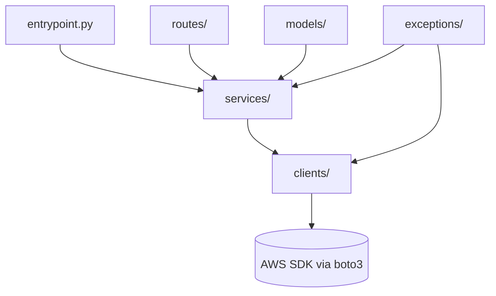

# Backend — serverless-telemetry-alerts-demo

uv workspace holding one strictly-layered package per workload (Lambda
function, Batch job, or ECS service).

## Intent & Non-Goals

**Intent.** Keep every workload on the same object-oriented layering:
`models/` (Pydantic), `exceptions/` (domain errors), `clients/` (the only
place allowed to import boto3), `services/` (pure business logic receiving
clients via injection), plus `routes/` and `docs/` for API workloads.

**Non-goals.** No inline comments (docstrings only, enforced at tokenizer
level). No business logic in `entrypoint.py`. No AWS SDK calls outside
`clients/` (enforced by AST gate).

## Architecture

## Testing

- `tests/unit/` mirrors each package and runs fully offline with moto.
- `tests/integration/` runs against the local floci stack on `:4566`.

## Known Caveats & Next Steps

- No workloads exist yet. `harness stack add` scaffolds the first package
  including its `clients/base.py` and unit-test skeleton.
