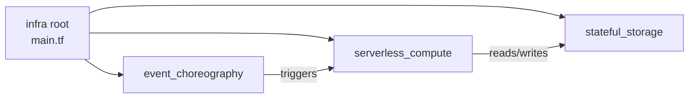

# Infrastructure — serverless-telemetry-alerts-demo

Terraform root for the `dev` stage. Wiring lives in `main.tf`; reusable
logic lives in the locked logical modules under `modules/`.

## Intent & Non-Goals

**Intent.** Compose certified logical modules with strict variable
validation; keep the root readable in one sitting; document every variable
and output through `description` plus terraform-docs.

**Non-goals.** Modules are logical capabilities, not raw resource wrappers,
and are read-only during stack composition. Sensitive values are never read
through `data "aws_ssm_parameter"` or `data "aws_secretsmanager_secret_version"`;
workloads resolve SSM paths and secret ARNs at runtime instead.

## Architecture

## Module Catalog

| Module | Capability |
| --- | --- |
| `serverless_compute` | Lambda + IAM role + log group + event triggers + optional DLQ |
| `event_choreography` | SQS queues, SNS fan-out, EventBridge bus with redrive DLQs |
| `stateful_storage` | DynamoDB with PITR, encrypted S3, SSM parameter placeholders |

## Inputs & Outputs

<!-- BEGIN_TF_DOCS -->
## Requirements

| Name | Version |
| ---- | ------- |
|  [terraform](#requirement\_terraform) | ~> 1.15.8 |
|  [aws](#requirement\_aws) | ~> 6.0 |

## Providers

No providers.

## Modules

No modules.

## Resources

No resources.

## Inputs

| Name | Description | Type | Default | Required |
| ---- | ----------- | ---- | ------- | :------: |
|  [aws\_region](#input\_aws\_region) | Primary AWS region for all resources. | `string` | `"eu-west-3"` | no |
|  [environment](#input\_environment) | Deployment stage; controls naming and sizing switches. | `string` | `"dev"` | no |
|  [project\_name](#input\_project\_name) | Project slug used as prefix for all resource names. | `string` | `"serverless-telemetry-alerts-demo"` | no |

## Outputs

No outputs.
<!-- END_TF_DOCS -->

## Known Caveats & Next Steps

- Every module ships `terraform test` fixtures (mock provider); run
  `terraform test` inside a module directory after any change.
- Tier-2 resources that have no certified module live only in `custom_*.tf`
  files at this root and must carry a state-file caveat.
