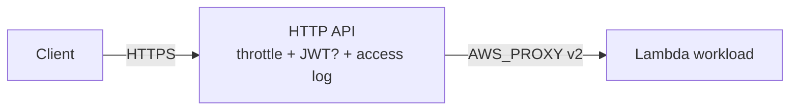

# api_edge

Logical capability: an API Gateway HTTP API (v2) fronting one Lambda
function — with throttling, optional JWT auth, optional CORS, and access
logging on by default.

## Intent & Non-Goals

**Intent.** One cheap, hardened HTTP edge per API workload: payload format
2.0 proxy integration, `$default` catch-all route, auto-deployed stage,
and CloudWatch access logs.

**Non-goals.** No REST API (v1) resources, no custom domains, no ALB
variant yet. Route-level composition belongs to the FastAPI app inside the
workload, not to API Gateway route resources.

## Architecture

## Inputs & Outputs

<!-- BEGIN_TF_DOCS -->
## Requirements

| Name | Version |
| ---- | ------- |
|  [terraform](#requirement\_terraform) | >= 1.9 |
|  [aws](#requirement\_aws) | >= 6.0 |

## Providers

| Name | Version |
| ---- | ------- |
|  [aws](#provider\_aws) | >= 6.0 |

## Modules

No modules.

## Resources

| Name | Type |
| ---- | ---- |
| [aws_apigatewayv2_api.this](https://registry.terraform.io/providers/hashicorp/aws/latest/docs/resources/apigatewayv2_api) | resource |
| [aws_apigatewayv2_authorizer.jwt](https://registry.terraform.io/providers/hashicorp/aws/latest/docs/resources/apigatewayv2_authorizer) | resource |
| [aws_apigatewayv2_integration.lambda](https://registry.terraform.io/providers/hashicorp/aws/latest/docs/resources/apigatewayv2_integration) | resource |
| [aws_apigatewayv2_route.catch_all](https://registry.terraform.io/providers/hashicorp/aws/latest/docs/resources/apigatewayv2_route) | resource |
| [aws_apigatewayv2_stage.this](https://registry.terraform.io/providers/hashicorp/aws/latest/docs/resources/apigatewayv2_stage) | resource |
| [aws_cloudwatch_log_group.access](https://registry.terraform.io/providers/hashicorp/aws/latest/docs/resources/cloudwatch_log_group) | resource |
| [aws_lambda_permission.apigw](https://registry.terraform.io/providers/hashicorp/aws/latest/docs/resources/lambda_permission) | resource |

## Inputs

| Name | Description | Type | Default | Required |
| ---- | ----------- | ---- | ------- | :------: |
|  [auth\_mode](#input\_auth\_mode) | Authorizer mode: none or jwt (issuer + audience required). | `string` | `"none"` | no |
|  [cors\_allowed\_origins](#input\_cors\_allowed\_origins) | CORS origins; empty disables CORS configuration. | `list(string)` | `[]` | no |
|  [enable\_access\_log](#input\_enable\_access\_log) | Write access logs to a dedicated CloudWatch log group. | `bool` | `true` | no |
|  [function\_name](#input\_function\_name) | Function name for the lambda permission statement. | `string` | n/a | yes |
|  [invoke\_arn](#input\_invoke\_arn) | Invoke ARN of the Lambda function backing the API. | `string` | n/a | yes |
|  [jwt\_audience](#input\_jwt\_audience) | Allowed JWT audiences. | `list(string)` | `[]` | no |
|  [jwt\_issuer](#input\_jwt\_issuer) | OIDC issuer URL for JWT auth. | `string` | `null` | no |
|  [log\_retention\_days](#input\_log\_retention\_days) | CloudWatch retention for the access log group. | `number` | `30` | no |
|  [name](#input\_name) | API name; prefixes its log group and resources. | `string` | n/a | yes |
|  [stage\_name](#input\_stage\_name) | API stage; $default serves at the root URL. | `string` | `"$default"` | no |
|  [tags](#input\_tags) | Extra tags merged onto every taggable resource. | `map(string)` | `{}` | no |
|  [throttle\_burst\_limit](#input\_throttle\_burst\_limit) | Burst requests allowed above the rate limit. | `number` | `200` | no |
|  [throttle\_rate\_limit](#input\_throttle\_rate\_limit) | Steady-state requests per second. | `number` | `100` | no |

## Outputs

| Name | Description |
| ---- | ----------- |
|  [api\_arn](#output\_api\_arn) | API ARN for policies and WAF attachments. |
|  [api\_endpoint](#output\_api\_endpoint) | Invoke URL of the API (includes the stage when not $default). |
|  [api\_id](#output\_api\_id) | API Gateway v2 API id. |
|  [execution\_arn](#output\_execution\_arn) | Execution ARN used for scoping invoke permissions. |
<!-- END_TF_DOCS -->

## Known Caveats & Next Steps

- JWT auth requires issuer and audience; anything else (IAM auth, Lambda
  authorizers, WAF) is a future work order.
- Custom domains and usage plans are intentionally out of scope for v1.
