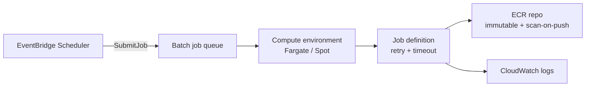

# batch_compute

Logical capability: an AWS Batch on Fargate job — compute environment,
job queue, job definition with retries and timeout, ECR repository, and an
optional EventBridge Scheduler trigger that submits the job.

## Intent & Non-Goals

**Intent.** One hardened batch pattern per workload: Fargate or
Fargate-Spot compute, immutable scan-on-push ECR, structured logs,
least-privilege job role, secrets as container secrets.

**Non-goals.** No EC2-backed compute environments, no multi-node jobs, no
job-level spot bidding strategies beyond the FARGATE_SPOT switch.

## Architecture

## Inputs & Outputs

<!-- BEGIN_TF_DOCS -->
## Requirements

| Name | Version |
| ---- | ------- |
|  [terraform](#requirement\_terraform) | >= 1.9 |
|  [aws](#requirement\_aws) | >= 6.0 |

## Providers

| Name | Version |
| ---- | ------- |
|  [aws](#provider\_aws) | >= 6.0 |

## Modules

No modules.

## Resources

| Name | Type |
| ---- | ---- |
| [aws_batch_compute_environment.this](https://registry.terraform.io/providers/hashicorp/aws/latest/docs/resources/batch_compute_environment) | resource |
| [aws_batch_job_definition.this](https://registry.terraform.io/providers/hashicorp/aws/latest/docs/resources/batch_job_definition) | resource |
| [aws_batch_job_queue.this](https://registry.terraform.io/providers/hashicorp/aws/latest/docs/resources/batch_job_queue) | resource |
| [aws_cloudwatch_log_group.this](https://registry.terraform.io/providers/hashicorp/aws/latest/docs/resources/cloudwatch_log_group) | resource |
| [aws_ecr_repository.this](https://registry.terraform.io/providers/hashicorp/aws/latest/docs/resources/ecr_repository) | resource |
| [aws_iam_role.execution](https://registry.terraform.io/providers/hashicorp/aws/latest/docs/resources/iam_role) | resource |
| [aws_iam_role.job](https://registry.terraform.io/providers/hashicorp/aws/latest/docs/resources/iam_role) | resource |
| [aws_iam_role.scheduler](https://registry.terraform.io/providers/hashicorp/aws/latest/docs/resources/iam_role) | resource |
| [aws_iam_role_policy.execution_secrets](https://registry.terraform.io/providers/hashicorp/aws/latest/docs/resources/iam_role_policy) | resource |
| [aws_iam_role_policy.job_app](https://registry.terraform.io/providers/hashicorp/aws/latest/docs/resources/iam_role_policy) | resource |
| [aws_iam_role_policy.scheduler](https://registry.terraform.io/providers/hashicorp/aws/latest/docs/resources/iam_role_policy) | resource |
| [aws_iam_role_policy_attachment.execution_managed](https://registry.terraform.io/providers/hashicorp/aws/latest/docs/resources/iam_role_policy_attachment) | resource |
| [aws_scheduler_schedule.this](https://registry.terraform.io/providers/hashicorp/aws/latest/docs/resources/scheduler_schedule) | resource |
| [aws_region.current](https://registry.terraform.io/providers/hashicorp/aws/latest/docs/data-sources/region) | data source |

## Inputs

| Name | Description | Type | Default | Required |
| ---- | ----------- | ---- | ------- | :------: |
|  [command](#input\_command) | Container command override; empty uses the image default. | `list(string)` | `[]` | no |
|  [compute\_type](#input\_compute\_type) | FARGATE for on-demand capacity, FARGATE\_SPOT for cheaper interruptible capacity. | `string` | `"FARGATE"` | no |
|  [create\_ecr](#input\_create\_ecr) | Create the ECR repository with scan-on-push and immutable tags. | `bool` | `true` | no |
|  [environment](#input\_environment) | Plain environment variables injected into the job container. | `map(string)` | `{}` | no |
|  [image\_uri](#input\_image\_uri) | Full container image URI for the job definition. | `string` | n/a | yes |
|  [log\_retention\_days](#input\_log\_retention\_days) | CloudWatch retention for job logs. | `number` | `30` | no |
|  [memory](#input\_memory) | Job memory in MB. | `number` | `2048` | no |
|  [name](#input\_name) | Job name; prefixes queue, definition, roles, and log group. | `string` | n/a | yes |
|  [policy\_statements](#input\_policy\_statements) | Least-privilege IAM statements for the job role. | <pre>list(object({     actions   = list(string)     resources = list(string)   }))</pre> | `[]` | no |
|  [retry\_attempts](#input\_retry\_attempts) | Job retry attempts on failure. | `number` | `2` | no |
|  [secrets](#input\_secrets) | Map of env var name to Secrets Manager ARN injected as job secrets. | `map(string)` | `{}` | no |
|  [security\_group\_ids](#input\_security\_group\_ids) | Security groups for job networking. | `list(string)` | `[]` | no |
|  [subnet\_ids](#input\_subnet\_ids) | Subnet IDs for the Fargate compute environment. | `list(string)` | `[]` | no |
|  [tags](#input\_tags) | Extra tags merged onto every taggable resource. | `map(string)` | `{}` | no |
|  [timeout\_seconds](#input\_timeout\_seconds) | Hard job timeout in seconds. | `number` | `3600` | no |
|  [trigger\_schedule](#input\_trigger\_schedule) | Optional EventBridge Scheduler expression that submits the job. | `string` | `null` | no |
|  [vcpus](#input\_vcpus) | Job vCPU allocation. | `number` | `1` | no |

## Outputs

| Name | Description |
| ---- | ----------- |
|  [ecr\_repository\_url](#output\_ecr\_repository\_url) | ECR repository URL; null when create\_ecr is false. |
|  [job\_definition\_arn](#output\_job\_definition\_arn) | Batch job definition ARN. |
|  [job\_queue\_arn](#output\_job\_queue\_arn) | Batch job queue ARN. |
|  [job\_queue\_name](#output\_job\_queue\_name) | Batch job queue name. |
|  [log\_group\_name](#output\_log\_group\_name) | CloudWatch log group receiving job logs. |
<!-- END_TF_DOCS -->

## Known Caveats & Next Steps

- floci emulates the Batch control plane and fast-completes submitted jobs;
  validate the actual container workload by running pytest inside the built
  image (the harness floci gate does this when a stack is containerized).
- `compute_resources` requires subnets; pass private subnets for anything
  touching internal data.
