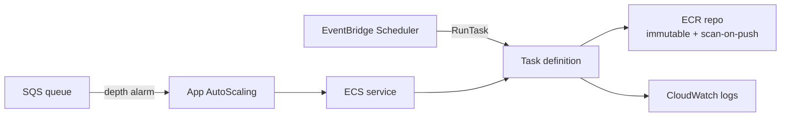

# container_service_ecs

Logical capability: an ECS Fargate workload with its ECR repository,
task/execution roles, log group, and three execution modes — long-running
service, SQS-depth autoscaled worker, or EventBridge-scheduled task.

## Intent & Non-Goals

**Intent.** One hardened Fargate pattern per containerized workload:
immutable scan-on-push ECR, secrets injected as container secrets (never
plain env), enhanced container insights, and least-privilege task roles.

**Non-goals.** No ALB ingress in v1 (services are internal or
queue-driven); no blue/green deployments; no EC2 launch type.

## Architecture

## Inputs & Outputs

<!-- BEGIN_TF_DOCS -->
## Requirements

| Name | Version |
| ---- | ------- |
|  [terraform](#requirement\_terraform) | >= 1.9 |
|  [aws](#requirement\_aws) | >= 6.0 |

## Providers

| Name | Version |
| ---- | ------- |
|  [aws](#provider\_aws) | >= 6.0 |

## Modules

No modules.

## Resources

| Name | Type |
| ---- | ---- |
| [aws_appautoscaling_policy.queue_depth](https://registry.terraform.io/providers/hashicorp/aws/latest/docs/resources/appautoscaling_policy) | resource |
| [aws_appautoscaling_target.this](https://registry.terraform.io/providers/hashicorp/aws/latest/docs/resources/appautoscaling_target) | resource |
| [aws_cloudwatch_log_group.this](https://registry.terraform.io/providers/hashicorp/aws/latest/docs/resources/cloudwatch_log_group) | resource |
| [aws_cloudwatch_metric_alarm.queue_depth](https://registry.terraform.io/providers/hashicorp/aws/latest/docs/resources/cloudwatch_metric_alarm) | resource |
| [aws_ecr_repository.this](https://registry.terraform.io/providers/hashicorp/aws/latest/docs/resources/ecr_repository) | resource |
| [aws_ecs_cluster.this](https://registry.terraform.io/providers/hashicorp/aws/latest/docs/resources/ecs_cluster) | resource |
| [aws_ecs_service.this](https://registry.terraform.io/providers/hashicorp/aws/latest/docs/resources/ecs_service) | resource |
| [aws_ecs_task_definition.this](https://registry.terraform.io/providers/hashicorp/aws/latest/docs/resources/ecs_task_definition) | resource |
| [aws_iam_role.execution](https://registry.terraform.io/providers/hashicorp/aws/latest/docs/resources/iam_role) | resource |
| [aws_iam_role.scheduler](https://registry.terraform.io/providers/hashicorp/aws/latest/docs/resources/iam_role) | resource |
| [aws_iam_role.task](https://registry.terraform.io/providers/hashicorp/aws/latest/docs/resources/iam_role) | resource |
| [aws_iam_role_policy.execution_secrets](https://registry.terraform.io/providers/hashicorp/aws/latest/docs/resources/iam_role_policy) | resource |
| [aws_iam_role_policy.scheduler](https://registry.terraform.io/providers/hashicorp/aws/latest/docs/resources/iam_role_policy) | resource |
| [aws_iam_role_policy.task_app](https://registry.terraform.io/providers/hashicorp/aws/latest/docs/resources/iam_role_policy) | resource |
| [aws_iam_role_policy_attachment.execution_managed](https://registry.terraform.io/providers/hashicorp/aws/latest/docs/resources/iam_role_policy_attachment) | resource |
| [aws_scheduler_schedule.this](https://registry.terraform.io/providers/hashicorp/aws/latest/docs/resources/scheduler_schedule) | resource |
| [aws_region.current](https://registry.terraform.io/providers/hashicorp/aws/latest/docs/data-sources/region) | data source |

## Inputs

| Name | Description | Type | Default | Required |
| ---- | ----------- | ---- | ------- | :------: |
|  [assign\_public\_ip](#input\_assign\_public\_ip) | Assign public IPs to tasks; keep false with private subnets. | `bool` | `false` | no |
|  [cpu](#input\_cpu) | Fargate task CPU units. | `number` | `256` | no |
|  [create\_ecr](#input\_create\_ecr) | Create the ECR repository with scan-on-push and immutable tags. | `bool` | `true` | no |
|  [desired\_count](#input\_desired\_count) | Tasks kept running in service or worker modes. | `number` | `1` | no |
|  [environment](#input\_environment) | Plain environment variables injected into the container. | `map(string)` | `{}` | no |
|  [execution\_mode](#input\_execution\_mode) | service for a long-running service, sqs\_autoscale\_worker to scale on queue depth, scheduled\_task for cron. | `string` | `"sqs_autoscale_worker"` | no |
|  [image\_uri](#input\_image\_uri) | Full container image URI, e.g. <account>.dkr.ecr.<region>.amazonaws.com/<repo>:<tag>. | `string` | n/a | yes |
|  [log\_retention\_days](#input\_log\_retention\_days) | CloudWatch retention for task logs. | `number` | `30` | no |
|  [memory](#input\_memory) | Fargate task memory in MB. | `number` | `512` | no |
|  [name](#input\_name) | Service name; prefixes cluster, task, roles, and log group. | `string` | n/a | yes |
|  [policy\_statements](#input\_policy\_statements) | Least-privilege IAM statements for the task role. | <pre>list(object({     actions   = list(string)     resources = list(string)   }))</pre> | `[]` | no |
|  [queue\_arn](#input\_queue\_arn) | SQS queue ARN driving autoscaling in sqs\_autoscale\_worker mode. | `string` | `null` | no |
|  [schedule\_expression](#input\_schedule\_expression) | Scheduler expression (rate/cron) in scheduled\_task mode. | `string` | `null` | no |
|  [secrets](#input\_secrets) | Map of env var name to Secrets Manager ARN injected as container secrets. | `map(string)` | `{}` | no |
|  [security\_group\_ids](#input\_security\_group\_ids) | Security groups attached to tasks. | `list(string)` | `[]` | no |
|  [subnet\_ids](#input\_subnet\_ids) | Subnet IDs for task placement. | `list(string)` | `[]` | no |
|  [tags](#input\_tags) | Extra tags merged onto every taggable resource. | `map(string)` | `{}` | no |

## Outputs

| Name | Description |
| ---- | ----------- |
|  [cluster\_name](#output\_cluster\_name) | ECS cluster name. |
|  [ecr\_repository\_url](#output\_ecr\_repository\_url) | ECR repository URL; null when create\_ecr is false. |
|  [log\_group\_name](#output\_log\_group\_name) | CloudWatch log group receiving task logs. |
|  [service\_name](#output\_service\_name) | ECS service name; null in scheduled\_task mode. |
|  [task\_definition\_arn](#output\_task\_definition\_arn) | Task definition ARN. |
<!-- END_TF_DOCS -->

## Known Caveats & Next Steps

- floci emulates ECS with a real container backend; Batch is control-plane
  only — validate Batch workloads by running pytest inside the built image.
- The image must be pushed before tasks can run; the harness floci gate
  builds and pushes it between apply and integration tests.
