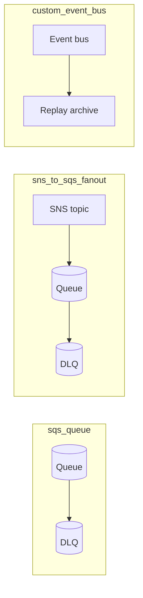

# event_choreography

Logical capability: the asynchronous messaging backbone of a stack — an SQS
queue with redrive DLQ, an SNS-to-SQS fan-out, or a custom EventBridge bus
with optional replay archive.

## Intent & Non-Goals

**Intent.** Make redrive DLQs the default, keep encryption on by default
(aws-managed SSE, CMK optional), and encode the three supported topologies
behind one typed `pattern` switch so wiring stays reviewable in `main.tf`.

**Non-goals.** Consumer Lambdas and their event source mappings belong to
`serverless_compute`; this module owns only the messaging resources and
their access policies. EventBridge rules/targets are wired in the root
`main.tf` per stack.

## Architecture

## Inputs & Outputs

<!-- BEGIN_TF_DOCS -->
## Requirements

| Name | Version |
| ---- | ------- |
|  [terraform](#requirement\_terraform) | >= 1.9 |
|  [aws](#requirement\_aws) | >= 6.0 |

## Providers

| Name | Version |
| ---- | ------- |
|  [aws](#provider\_aws) | >= 6.0 |

## Modules

No modules.

## Resources

| Name | Type |
| ---- | ---- |
| [aws_cloudwatch_event_archive.this](https://registry.terraform.io/providers/hashicorp/aws/latest/docs/resources/cloudwatch_event_archive) | resource |
| [aws_cloudwatch_event_bus.this](https://registry.terraform.io/providers/hashicorp/aws/latest/docs/resources/cloudwatch_event_bus) | resource |
| [aws_sns_topic.this](https://registry.terraform.io/providers/hashicorp/aws/latest/docs/resources/sns_topic) | resource |
| [aws_sns_topic_subscription.queue](https://registry.terraform.io/providers/hashicorp/aws/latest/docs/resources/sns_topic_subscription) | resource |
| [aws_sqs_queue.dlq](https://registry.terraform.io/providers/hashicorp/aws/latest/docs/resources/sqs_queue) | resource |
| [aws_sqs_queue.this](https://registry.terraform.io/providers/hashicorp/aws/latest/docs/resources/sqs_queue) | resource |
| [aws_sqs_queue_policy.fanout](https://registry.terraform.io/providers/hashicorp/aws/latest/docs/resources/sqs_queue_policy) | resource |

## Inputs

| Name | Description | Type | Default | Required |
| ---- | ----------- | ---- | ------- | :------: |
|  [archive\_days](#input\_archive\_days) | EventBridge archive retention in days for replay; 0 disables the archive. | `number` | `0` | no |
|  [enable\_redrive\_dlq](#input\_enable\_redrive\_dlq) | Attach a dead-letter queue with a redrive policy to the main queue. | `bool` | `true` | no |
|  [fifo\_content\_based\_deduplication](#input\_fifo\_content\_based\_deduplication) | Let SQS/SNS deduplicate by content hash instead of explicit dedup ids. | `bool` | `false` | no |
|  [fifo\_enabled](#input\_fifo\_enabled) | Use FIFO semantics (strict ordering, exactly-once) for queue or fanout. | `bool` | `false` | no |
|  [max\_receive\_count](#input\_max\_receive\_count) | Deliveries attempted before a message moves to the DLQ. | `number` | `3` | no |
|  [name](#input\_name) | Base name for the queue, topic, or event bus. | `string` | n/a | yes |
|  [pattern](#input\_pattern) | Messaging topology to provision. | `string` | `"sqs_queue"` | no |
|  [queue\_kms\_key\_arn](#input\_queue\_kms\_key\_arn) | Customer-managed CMK for queue/topic encryption; aws-managed SSE when null. | `string` | `null` | no |
|  [tags](#input\_tags) | Extra tags merged onto every taggable resource. | `map(string)` | `{}` | no |
|  [visibility\_timeout\_seconds](#input\_visibility\_timeout\_seconds) | Queue visibility timeout; set to at least 6x the consumer Lambda timeout. | `number` | `30` | no |

## Outputs

| Name | Description |
| ---- | ----------- |
|  [dlq\_arn](#output\_dlq\_arn) | Dead-letter queue ARN; null when redrive is disabled or on bus pattern. |
|  [dlq\_url](#output\_dlq\_url) | Dead-letter queue URL; null when redrive is disabled or on bus pattern. |
|  [event\_bus\_arn](#output\_event\_bus\_arn) | EventBridge bus ARN; only set for the custom\_event\_bus pattern. |
|  [event\_bus\_name](#output\_event\_bus\_name) | EventBridge bus name; only set for the custom\_event\_bus pattern. |
|  [queue\_arn](#output\_queue\_arn) | Main queue ARN; null for the custom\_event\_bus pattern. |
|  [queue\_name](#output\_queue\_name) | Main queue name; null for the custom\_event\_bus pattern. |
|  [queue\_url](#output\_queue\_url) | Main queue URL; null for the custom\_event\_bus pattern. |
|  [topic\_arn](#output\_topic\_arn) | SNS topic ARN; only set for the sns\_to\_sqs\_fanout pattern. |
<!-- END_TF_DOCS -->

## Known Caveats & Next Steps

- Standard queues are the default; set `fifo_enabled` when strict ordering
  or exactly-once processing is a business requirement (throughput drops).
- Set `visibility_timeout_seconds` to at least 6x the consumer's timeout to
  avoid duplicate processing of slow batches.
- SNS topics without a CMK rely on SQS-managed SSE at the queue; provide
  `queue_kms_key_arn` when the topic itself must be CMK-encrypted.
