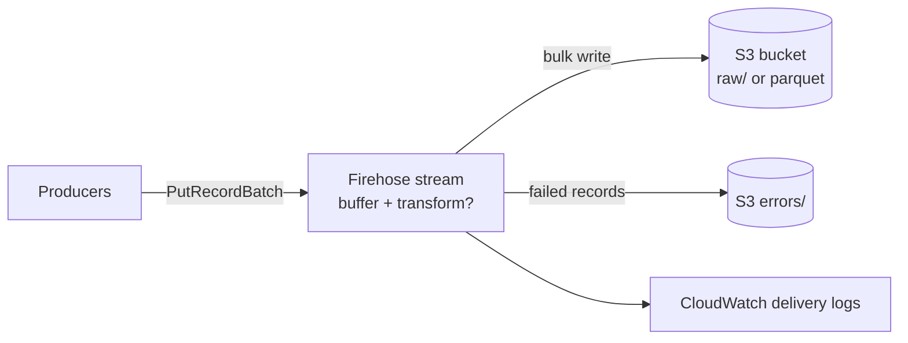

# firehose_ingestion

Logical capability: an Amazon Data Firehose delivery stream into S3 —
raw or Parquet-converted via Glue — with buffering, compression, optional
inline Lambda transformation, and delivery logging.

## Intent & Non-Goals

**Intent.** One hardened ingestion path per stack: extended S3 delivery
with CloudWatch logging, scoped S3 write permissions, and error output
isolated under its own prefix.

**Non-goals.** No MSK/Kinesis source attachment (producers put records
directly); no Redshift/OpenSearch destinations. The Glue catalog database
and table are referenced, never created here — they belong to the data
stack.

## Architecture

## Inputs & Outputs

<!-- BEGIN_TF_DOCS -->
## Requirements

| Name | Version |
| ---- | ------- |
|  [terraform](#requirement\_terraform) | >= 1.9 |
|  [aws](#requirement\_aws) | >= 6.0 |

## Providers

| Name | Version |
| ---- | ------- |
|  [aws](#provider\_aws) | >= 6.0 |

## Modules

No modules.

## Resources

| Name | Type |
| ---- | ---- |
| [aws_cloudwatch_log_group.this](https://registry.terraform.io/providers/hashicorp/aws/latest/docs/resources/cloudwatch_log_group) | resource |
| [aws_cloudwatch_log_stream.delivery](https://registry.terraform.io/providers/hashicorp/aws/latest/docs/resources/cloudwatch_log_stream) | resource |
| [aws_iam_role.this](https://registry.terraform.io/providers/hashicorp/aws/latest/docs/resources/iam_role) | resource |
| [aws_iam_role_policy.glue_read](https://registry.terraform.io/providers/hashicorp/aws/latest/docs/resources/iam_role_policy) | resource |
| [aws_iam_role_policy.lambda_transform](https://registry.terraform.io/providers/hashicorp/aws/latest/docs/resources/iam_role_policy) | resource |
| [aws_iam_role_policy.s3_write](https://registry.terraform.io/providers/hashicorp/aws/latest/docs/resources/iam_role_policy) | resource |
| [aws_kinesis_firehose_delivery_stream.this](https://registry.terraform.io/providers/hashicorp/aws/latest/docs/resources/kinesis_firehose_delivery_stream) | resource |

## Inputs

| Name | Description | Type | Default | Required |
| ---- | ----------- | ---- | ------- | :------: |
|  [bucket\_arn](#input\_bucket\_arn) | ARN of the destination S3 bucket (from stateful\_storage). | `string` | n/a | yes |
|  [buffering\_interval\_seconds](#input\_buffering\_interval\_seconds) | Buffer interval before delivery, in seconds (60-900). | `number` | `300` | no |
|  [buffering\_size\_mb](#input\_buffering\_size\_mb) | Buffer size before delivery, in MB (1-128). | `number` | `5` | no |
|  [compression](#input\_compression) | Compression for delivered objects. | `string` | `"GZIP"` | no |
|  [destination](#input\_destination) | s3\_raw for raw delivery; s3\_parquet\_glue adds Parquet conversion via Glue. | `string` | `"s3_raw"` | no |
|  [enable\_lambda\_transform](#input\_enable\_lambda\_transform) | Run an inline Lambda record transformation before delivery. | `bool` | `false` | no |
|  [error\_prefix](#input\_error\_prefix) | S3 key prefix for failed records. | `string` | `"errors/"` | no |
|  [glue\_database\_name](#input\_glue\_database\_name) | Glue database for Parquet schema conversion. | `string` | `null` | no |
|  [glue\_table\_name](#input\_glue\_table\_name) | Glue table for Parquet schema conversion. | `string` | `null` | no |
|  [name](#input\_name) | Delivery stream name; prefixes its role and log group. | `string` | n/a | yes |
|  [prefix](#input\_prefix) | S3 key prefix for delivered records. | `string` | `"raw/"` | no |
|  [tags](#input\_tags) | Extra tags merged onto every taggable resource. | `map(string)` | `{}` | no |
|  [transform\_lambda\_arn](#input\_transform\_lambda\_arn) | ARN of the transformation Lambda when enable\_lambda\_transform is true. | `string` | `null` | no |

## Outputs

| Name | Description |
| ---- | ----------- |
|  [delivery\_stream\_arn](#output\_delivery\_stream\_arn) | Firehose delivery stream ARN. |
|  [delivery\_stream\_name](#output\_delivery\_stream\_name) | Firehose delivery stream name. |
|  [role\_arn](#output\_role\_arn) | Firehose role ARN for extra permissions outside this module. |
<!-- END_TF_DOCS -->

## Known Caveats & Next Steps

- floci flushes on `FLOCI_SERVICES_FIREHOSE_FLUSH_RECORD_COUNT`; set it to
  1 in integration tests so records appear immediately.
- Parquet conversion needs the Glue database and table to exist; create
  them via a `custom_*.tf` escape hatch or a future data catalog module.
