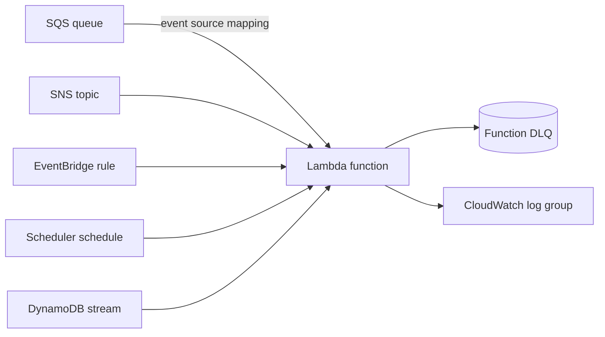

# serverless_compute

Logical capability: one Lambda function with its execution role, scoped
logging policy, CloudWatch log group, optional event triggers, and an
optional function-level dead-letter queue.

## Intent & Non-Goals

**Intent.** Give every workload the same hardened baseline — scoped log
permissions, retention, optional CMK, optional VPC — while keeping trigger
wiring declarative through the `triggers` object (sqs, sns, eventbridge,
schedule, dynamodb_stream, s3).

**Non-goals.** Queue-side redrive policies belong to the queue owner
(see `event_choreography`); this module's DLQ only covers asynchronous
invocations. Container image builds happen outside this module, which only
consumes a finished `image_uri`.

## Architecture

## Inputs & Outputs

<!-- BEGIN_TF_DOCS -->
## Requirements

| Name | Version |
| ---- | ------- |
|  [terraform](#requirement\_terraform) | >= 1.9 |
|  [aws](#requirement\_aws) | >= 6.0 |

## Providers

| Name | Version |
| ---- | ------- |
|  [aws](#provider\_aws) | >= 6.0 |

## Modules

No modules.

## Resources

| Name | Type |
| ---- | ---- |
| [aws_cloudwatch_log_group.this](https://registry.terraform.io/providers/hashicorp/aws/latest/docs/resources/cloudwatch_log_group) | resource |
| [aws_iam_role.scheduler](https://registry.terraform.io/providers/hashicorp/aws/latest/docs/resources/iam_role) | resource |
| [aws_iam_role.this](https://registry.terraform.io/providers/hashicorp/aws/latest/docs/resources/iam_role) | resource |
| [aws_iam_role_policy.app](https://registry.terraform.io/providers/hashicorp/aws/latest/docs/resources/iam_role_policy) | resource |
| [aws_iam_role_policy.logging](https://registry.terraform.io/providers/hashicorp/aws/latest/docs/resources/iam_role_policy) | resource |
| [aws_iam_role_policy.scheduler](https://registry.terraform.io/providers/hashicorp/aws/latest/docs/resources/iam_role_policy) | resource |
| [aws_iam_role_policy.sqs_trigger](https://registry.terraform.io/providers/hashicorp/aws/latest/docs/resources/iam_role_policy) | resource |
| [aws_iam_role_policy.stream_trigger](https://registry.terraform.io/providers/hashicorp/aws/latest/docs/resources/iam_role_policy) | resource |
| [aws_iam_role_policy_attachment.vpc](https://registry.terraform.io/providers/hashicorp/aws/latest/docs/resources/iam_role_policy_attachment) | resource |
| [aws_lambda_event_source_mapping.sqs](https://registry.terraform.io/providers/hashicorp/aws/latest/docs/resources/lambda_event_source_mapping) | resource |
| [aws_lambda_event_source_mapping.stream](https://registry.terraform.io/providers/hashicorp/aws/latest/docs/resources/lambda_event_source_mapping) | resource |
| [aws_lambda_function.this](https://registry.terraform.io/providers/hashicorp/aws/latest/docs/resources/lambda_function) | resource |
| [aws_lambda_permission.eventbridge](https://registry.terraform.io/providers/hashicorp/aws/latest/docs/resources/lambda_permission) | resource |
| [aws_lambda_permission.s3](https://registry.terraform.io/providers/hashicorp/aws/latest/docs/resources/lambda_permission) | resource |
| [aws_lambda_permission.sns](https://registry.terraform.io/providers/hashicorp/aws/latest/docs/resources/lambda_permission) | resource |
| [aws_s3_bucket_notification.this](https://registry.terraform.io/providers/hashicorp/aws/latest/docs/resources/s3_bucket_notification) | resource |
| [aws_scheduler_schedule.this](https://registry.terraform.io/providers/hashicorp/aws/latest/docs/resources/scheduler_schedule) | resource |
| [aws_sns_topic_subscription.this](https://registry.terraform.io/providers/hashicorp/aws/latest/docs/resources/sns_topic_subscription) | resource |
| [aws_sqs_queue.dlq](https://registry.terraform.io/providers/hashicorp/aws/latest/docs/resources/sqs_queue) | resource |

## Inputs

| Name | Description | Type | Default | Required |
| ---- | ----------- | ---- | ------- | :------: |
|  [dlq\_message\_retention\_seconds](#input\_dlq\_message\_retention\_seconds) | Retention for dead-lettered messages. | `number` | `1209600` | no |
|  [enable\_dlq](#input\_enable\_dlq) | Create a function-level SQS dead-letter queue for async invocations. | `bool` | `true` | no |
|  [environment\_variables](#input\_environment\_variables) | Plain environment variables; SSM paths and secret ARNs passed as strings. | `map(string)` | `{}` | no |
|  [filename](#input\_filename) | Path to the deployment zip; required when package\_type is Zip. | `string` | `null` | no |
|  [handler](#input\_handler) | Entrypoint such as order\_worker.entrypoint.handler; Zip only. | `string` | `null` | no |
|  [image\_uri](#input\_image\_uri) | ECR image URI; required when package\_type is Image. | `string` | `null` | no |
|  [kms\_key\_arn](#input\_kms\_key\_arn) | Customer-managed CMK for logs, env, and DLQ; aws-managed keys when null. | `string` | `null` | no |
|  [log\_retention\_days](#input\_log\_retention\_days) | CloudWatch log retention. | `number` | `30` | no |
|  [memory\_size](#input\_memory\_size) | Function memory in MB. | `number` | `256` | no |
|  [name](#input\_name) | Function name; also prefixes its role, log group, and DLQ. | `string` | n/a | yes |
|  [package\_type](#input\_package\_type) | Deployment artifact kind: Zip (handler/runtime) or Image (image\_uri). | `string` | `"Zip"` | no |
|  [policy\_statements](#input\_policy\_statements) | Least-privilege IAM statements merged into the execution role. | <pre>list(object({     actions   = list(string)     resources = list(string)   }))</pre> | `[]` | no |
|  [runtime](#input\_runtime) | Lambda runtime identifier; Zip only. | `string` | `"python3.13"` | no |
|  [source\_code\_hash](#input\_source\_code\_hash) | Base64 SHA256 of the zip; drives redeploy detection for Zip packages. | `string` | `null` | no |
|  [tags](#input\_tags) | Extra tags merged onto every taggable resource. | `map(string)` | `{}` | no |
|  [timeout](#input\_timeout) | Function timeout in seconds. | `number` | `30` | no |
|  [triggers](#input\_triggers) | Event sources wired to the function; only present keys create resources. | <pre>object({     sqs = optional(object({       queue_arn                       = string       batch_size                      = optional(number, 10)       maximum_batching_window_seconds = optional(number, 0)     }))     sns = optional(object({       topic_arn = string     }))     eventbridge = optional(object({       rule_arn = string     }))     schedule = optional(object({       expression = string     }))     dynamodb_stream = optional(object({       stream_arn        = string       batch_size        = optional(number, 100)       starting_position = optional(string, "LATEST")     }))     s3 = optional(object({       bucket_name   = string       bucket_arn    = string       events        = optional(list(string), ["s3:ObjectCreated:*"])       filter_prefix = optional(string)       filter_suffix = optional(string)     }))   })</pre> | `{}` | no |
|  [vpc\_security\_group\_ids](#input\_vpc\_security\_group\_ids) | Security groups attached when vpc\_subnet\_ids is set. | `list(string)` | `[]` | no |
|  [vpc\_subnet\_ids](#input\_vpc\_subnet\_ids) | Private subnet IDs; empty keeps the function outside any VPC. | `list(string)` | `[]` | no |

## Outputs

| Name | Description |
| ---- | ----------- |
|  [dlq\_arn](#output\_dlq\_arn) | Function-level dead-letter queue ARN; null when enable\_dlq is false. |
|  [dlq\_url](#output\_dlq\_url) | Function-level dead-letter queue URL; null when enable\_dlq is false. |
|  [function\_arn](#output\_function\_arn) | Deployed Lambda function ARN. |
|  [function\_name](#output\_function\_name) | Deployed Lambda function name. |
|  [log\_group\_name](#output\_log\_group\_name) | CloudWatch log group receiving function logs. |
|  [role\_arn](#output\_role\_arn) | Execution role ARN for extra attachments outside this module. |
<!-- END_TF_DOCS -->

## Known Caveats & Next Steps

- X-Ray tracing is intentionally not wired yet; add `tracing_config` when a
  stack requires distributed tracing.
- SQS queue redrive is owned by `event_choreography`; set
  `visibility_timeout_seconds` there to at least 6x this function's timeout.
- `policy_statements` accepts only scoped actions and resources; the
  `trivy config` gate rejects wildcards.
