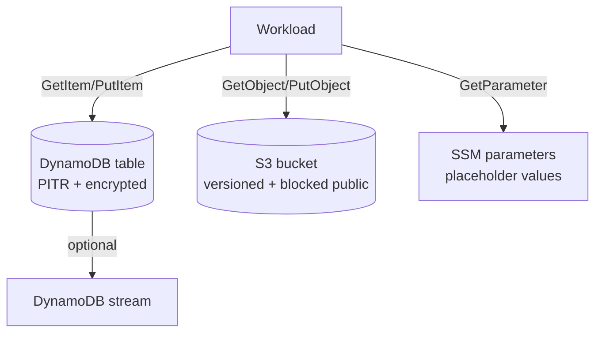

# stateful_storage

Logical capability: serverless persistence for a stack — a DynamoDB table
with point-in-time recovery, an optionally-provisioned hardened S3 bucket,
and SSM parameter placeholders that workloads resolve at runtime.

## Intent & Non-Goals

**Intent.** Make the secure posture the default: PITR on, encryption at
rest on, public access blocked, versioning on, incomplete multipart uploads
aborted. Key schema stays explicit (`pk`/`sk` overridable).

**Non-goals.** GSIs and autoscaling policies are stack-specific and are
added per work order, not guessed here. SSM parameters are placeholders:
Terraform never stores real secret values; workloads write and read them at
runtime (values are `ignore_changes`d).

## Architecture

## Inputs & Outputs

<!-- BEGIN_TF_DOCS -->
## Requirements

| Name | Version |
| ---- | ------- |
|  [terraform](#requirement\_terraform) | >= 1.9 |
|  [aws](#requirement\_aws) | >= 6.0 |

## Providers

| Name | Version |
| ---- | ------- |
|  [aws](#provider\_aws) | >= 6.0 |

## Modules

No modules.

## Resources

| Name | Type |
| ---- | ---- |
| [aws_dynamodb_table.this](https://registry.terraform.io/providers/hashicorp/aws/latest/docs/resources/dynamodb_table) | resource |
| [aws_s3_bucket.this](https://registry.terraform.io/providers/hashicorp/aws/latest/docs/resources/s3_bucket) | resource |
| [aws_s3_bucket_lifecycle_configuration.this](https://registry.terraform.io/providers/hashicorp/aws/latest/docs/resources/s3_bucket_lifecycle_configuration) | resource |
| [aws_s3_bucket_public_access_block.this](https://registry.terraform.io/providers/hashicorp/aws/latest/docs/resources/s3_bucket_public_access_block) | resource |
| [aws_s3_bucket_server_side_encryption_configuration.this](https://registry.terraform.io/providers/hashicorp/aws/latest/docs/resources/s3_bucket_server_side_encryption_configuration) | resource |
| [aws_s3_bucket_versioning.this](https://registry.terraform.io/providers/hashicorp/aws/latest/docs/resources/s3_bucket_versioning) | resource |
| [aws_ssm_parameter.this](https://registry.terraform.io/providers/hashicorp/aws/latest/docs/resources/ssm_parameter) | resource |

## Inputs

| Name | Description | Type | Default | Required |
| ---- | ----------- | ---- | ------- | :------: |
|  [deletion\_protection\_enabled](#input\_deletion\_protection\_enabled) | Deletion protection for the table; enable for staging and prod. | `bool` | `false` | no |
|  [dynamodb\_partition\_key](#input\_dynamodb\_partition\_key) | Partition key attribute; type is one of S, N, B. | <pre>object({     name = string     type = string   })</pre> | <pre>{   "name": "pk",   "type": "S" }</pre> | no |
|  [dynamodb\_sort\_key](#input\_dynamodb\_sort\_key) | Sort key attribute; type is one of S, N, B. | <pre>object({     name = string     type = string   })</pre> | <pre>{   "name": "sk",   "type": "S" }</pre> | no |
|  [enable\_dynamodb](#input\_enable\_dynamodb) | Provision the DynamoDB table. | `bool` | `true` | no |
|  [enable\_s3\_bucket](#input\_enable\_s3\_bucket) | Provision the hardened S3 bucket. | `bool` | `false` | no |
|  [enable\_streams](#input\_enable\_streams) | Enable DynamoDB streams (NEW\_AND\_OLD\_IMAGES) for CDC consumers. | `bool` | `false` | no |
|  [name](#input\_name) | Base name for the table, bucket, and parameter namespace. | `string` | n/a | yes |
|  [pitr\_enabled](#input\_pitr\_enabled) | Point-in-time recovery for the table; disabling is a prod blocker. | `bool` | `true` | no |
|  [s3\_force\_destroy](#input\_s3\_force\_destroy) | Allow Terraform to delete a non-empty bucket; dev convenience only. | `bool` | `false` | no |
|  [s3\_kms\_key\_arn](#input\_s3\_kms\_key\_arn) | Customer-managed CMK for bucket encryption; AES256 when null. | `string` | `null` | no |
|  [ssm\_parameters](#input\_ssm\_parameters) | SSM parameters created as placeholders; workloads overwrite values at runtime. | <pre>map(object({     value       = string     description = string   }))</pre> | `{}` | no |
|  [tags](#input\_tags) | Extra tags merged onto every taggable resource. | `map(string)` | `{}` | no |

## Outputs

| Name | Description |
| ---- | ----------- |
|  [bucket\_arn](#output\_bucket\_arn) | S3 bucket ARN; null when enable\_s3\_bucket is false. |
|  [bucket\_name](#output\_bucket\_name) | S3 bucket name; null when enable\_s3\_bucket is false. |
|  [ssm\_parameter\_names](#output\_ssm\_parameter\_names) | Map of requested SSM path to created parameter name. |
|  [table\_arn](#output\_table\_arn) | DynamoDB table ARN; null when enable\_dynamodb is false. |
|  [table\_name](#output\_table\_name) | DynamoDB table name; null when enable\_dynamodb is false. |
|  [table\_stream\_arn](#output\_table\_stream\_arn) | DynamoDB stream ARN; null unless streams are enabled. |
<!-- END_TF_DOCS -->

## Known Caveats & Next Steps

- `deletion_protection_enabled` defaults to false for dev ergonomics; turn
  it on for staging and prod tfvars.
- Bucket access logging and cross-region replication are not wired yet; add
  them when a stack handles regulated data.
- GSIs must be declared explicitly per stack; the module rejects implicit
  key guessing on purpose.
