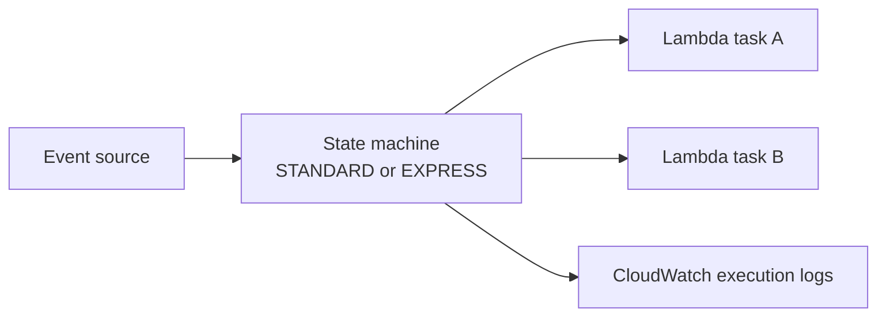

# step_functions_workflow

Logical capability: one Step Functions state machine with its execution
role, CloudWatch execution logs, and least-privilege Lambda invoke
permissions derived from `task_lambda_arns`.

## Intent & Non-Goals

**Intent.** Orchestrate multi-step backend work (Lambda tasks, waits,
retries, callbacks) with a hardened default: typed workflow switch,
structured execution logging, X-Ray flag, JSON-validated definition.

**Non-goals.** The module never guesses ASL content — the definition comes
from the stack's work order (or a `custom_*.tf` adjacent file).
EventBridge-triggered starts and `.waitForTaskToken` callback targets are
wired in the root `main.tf` per stack.

## Architecture

## Inputs & Outputs

<!-- BEGIN_TF_DOCS -->
## Requirements

| Name | Version |
| ---- | ------- |
|  [terraform](#requirement\_terraform) | >= 1.9 |
|  [aws](#requirement\_aws) | >= 6.0 |

## Providers

| Name | Version |
| ---- | ------- |
|  [aws](#provider\_aws) | >= 6.0 |

## Modules

No modules.

## Resources

| Name | Type |
| ---- | ---- |
| [aws_cloudwatch_log_group.this](https://registry.terraform.io/providers/hashicorp/aws/latest/docs/resources/cloudwatch_log_group) | resource |
| [aws_iam_role.this](https://registry.terraform.io/providers/hashicorp/aws/latest/docs/resources/iam_role) | resource |
| [aws_iam_role_policy.invoke_lambdas](https://registry.terraform.io/providers/hashicorp/aws/latest/docs/resources/iam_role_policy) | resource |
| [aws_iam_role_policy.logging](https://registry.terraform.io/providers/hashicorp/aws/latest/docs/resources/iam_role_policy) | resource |
| [aws_sfn_state_machine.this](https://registry.terraform.io/providers/hashicorp/aws/latest/docs/resources/sfn_state_machine) | resource |

## Inputs

| Name | Description | Type | Default | Required |
| ---- | ----------- | ---- | ------- | :------: |
|  [asl\_definition](#input\_asl\_definition) | Amazon States Language definition; reference task ARNs via task\_lambda\_arns. | `string` | n/a | yes |
|  [enable\_xray](#input\_enable\_xray) | Enable X-Ray tracing on executions. | `bool` | `false` | no |
|  [log\_level](#input\_log\_level) | Execution log level: OFF, ERROR, or ALL. | `string` | `"ERROR"` | no |
|  [log\_retention\_days](#input\_log\_retention\_days) | CloudWatch retention for execution logs. | `number` | `30` | no |
|  [name](#input\_name) | State machine name; prefixes its role and log group. | `string` | n/a | yes |
|  [tags](#input\_tags) | Extra tags merged onto every taggable resource. | `map(string)` | `{}` | no |
|  [task\_lambda\_arns](#input\_task\_lambda\_arns) | Map of logical task label to Lambda ARN; grants states InvokeFunction on each. | `map(string)` | `{}` | no |
|  [workflow\_type](#input\_workflow\_type) | STANDARD for durable long-running flows; EXPRESS for high-rate short ones. | `string` | `"STANDARD"` | no |

## Outputs

| Name | Description |
| ---- | ----------- |
|  [role\_arn](#output\_role\_arn) | Execution role ARN for extra task permissions outside this module. |
|  [state\_machine\_arn](#output\_state\_machine\_arn) | State machine ARN. |
|  [state\_machine\_name](#output\_state\_machine\_name) | State machine name. |
<!-- END_TF_DOCS -->

## Known Caveats & Next Steps

- floci emulates the control plane (`ValidateStateMachineDefinition`,
  `StartExecution`); real task execution is covered by unit tests.
- `logging_configuration` requires the role's log policy to exist first
  (handled via depends_on).
